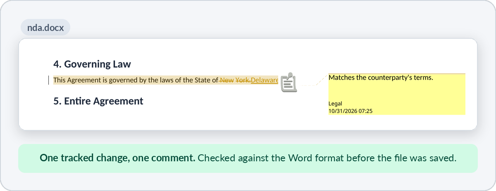
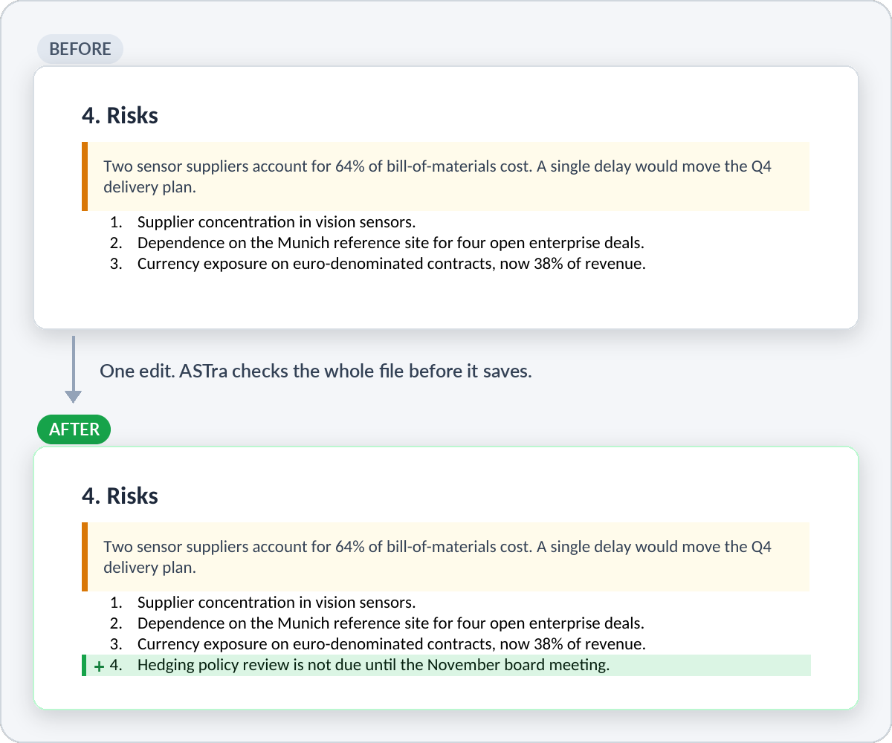
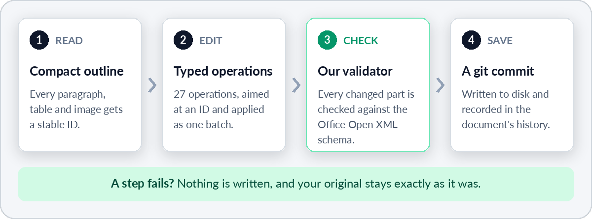

<h1 align="center">
  <picture>
    <source media="(prefers-color-scheme: dark)" srcset="docs/assets/astra-wordmark-dark.svg" />
    <source media="(prefers-color-scheme: light)" srcset="docs/assets/astra-wordmark-light.svg" />
    
  </picture>
</h1>

<p align="center">
  <strong>The agent-first toolkit for Word documents.</strong><br />
  Let AI agents read, edit and build <code>.docx</code> files, with every change validated and every save kept in a git history.
</p>

<p align="center">
  <a href="LICENSE"></a>
  <a href="https://nodejs.org/"></a>
  <a href="test-gallery/"></a>
</p>

<p align="center">
  <a href="https://attentionform.com"></a>
  <a href="https://discord.gg/YmJrmXUNF"></a>
  <a href="https://x.com/attentionform"></a>
</p>

<p align="center">
  <a href="https://www.npmjs.com/package/@attentionform/astra"></a>
  <a href="https://www.npmjs.com/package/@attentionform/astra-mcp-server"></a>
  <a href="https://www.npmjs.com/package/@attentionform/astra-engine"></a>
  <a href="https://www.npmjs.com/package/@attentionform/ooxml-validator"></a>
</p>

<p align="center">
  <a href="#quickstart">Quickstart</a> &nbsp;·&nbsp;
  <a href="#what-people-use-it-for">Use cases</a> &nbsp;·&nbsp;
  <a href="#our-own-validator">Validator</a> &nbsp;·&nbsp;
  <a href="#version-history-like-git">History</a> &nbsp;·&nbsp;
  <a href="#documentation">Docs</a>
</p>

**ASTra is an agent-first toolkit for Word (`.docx`) documents.** It lets an AI agent, or any script, read a document, change exactly what it needs to change, and build new documents from scratch, without ever touching the raw XML. It is not an office suite: there is no window, no toolbar and no cursor, only the layer an agent needs to work on a Word file safely.

It is powered by its own document engine, which turns a `.docx` into a compact tree of nodes with stable IDs. The engine comes with a [Model Context Protocol](https://modelcontextprotocol.io) (MCP) server, so AI assistants can use it directly, and a command-line tool for scripts and CI. ASTra is source-available.

**Why use it?** An agent that edits Word files by writing code, or by reading the raw XML, either burns its context window on markup or produces a file that Word has to repair. ASTra gives the agent a compact outline to read, typed operations to apply by ID, and a validator that refuses to save a broken file.

<table>
  <tr>
    <td width="33%" valign="top"><b>An outline made for agents</b><br />One row per paragraph, table and image, each with a stable ID. Roughly 5x fewer tokens than raw XML on our demo report.</td>
    <td width="33%" valign="top"><b>Typed, batched edits</b><br />27 operations aimed at node IDs and applied as one batch. If any step fails, none of it is applied.</td>
    <td width="33%" valign="top"><b>Built-in validation</b><br />Every file is validated against the Office Open XML schema before it is saved, by a validator package we ship ourselves. A file that fails is never written, so what comes out opens cleanly in Microsoft Word.</td>
  </tr>
  <tr>
    <td width="33%" valign="top"><b>Git history</b><br />Every save is a commit in a git repository kept next to the document. ASTra writes it itself, so git does not need to be installed. List it, preview a revert, restore, redo.</td>
    <td width="33%" valign="top"><b>Made for automation</b><br />JSON output, exit codes, batches from stdin, and one run per row of a CSV file.</td>
    <td width="33%" valign="top"><b>Local and bounded</b><br />Runs on your machine and sends nothing anywhere. The MCP server touches only the folder you name.</td>
  </tr>
</table>

## See it work

Two real edits. Each picture is rendered from the saved file.

### Redline a contract

> **You:** Open `nda.docx`, change the governing law from New York to Delaware as a tracked change, and add a comment saying why.

<p align="center">
  
</p>

The agent found the clause by its ID, made the change as a tracked change under an author name, and attached the comment. ASTra validated the whole file before it saved.

### Edit a report

> **You:** Open `board-report.docx`. Add a fourth risk to the list in section 4: the hedging policy review is not due until the November board meeting. Save it.

<p align="center">
  
</p>

The agent found the list by its ID and added one item; nothing else on the page changed. To watch an agent build and edit a whole report, see the [recorded session](https://attentionform.com/how-it-works).

## Every edit takes the same four steps

<p align="center">
  
</p>

## Quickstart

You need Node.js 22.19 or newer. Reading, editing, validating, sanitizing and the text page wireframe need nothing else; `npx` fetches what they need.

**PDF export and page images need two tools on your `PATH`:** [LibreOffice](https://www.libreoffice.org/) (`soffice`) exports PDFs and lays out pages, and [Poppler](https://poppler.freedesktop.org/) (`pdftoppm`) turns those pages into images. PDF export needs only LibreOffice; page images need both.

```bash
# Ubuntu / Debian / WSL
sudo apt-get install -y libreoffice-writer poppler-utils

# macOS
brew install --cask libreoffice && brew install poppler

# check
which soffice pdftoppm
```

Without them, those calls fail with `E_DEPENDENCY` and write nothing; everything else keeps working.

### Connect an AI assistant

Add ASTra to your assistant's MCP configuration. For Claude Desktop that is `claude_desktop_config.json` (`~/Library/Application Support/Claude/` on macOS, `%APPDATA%\Claude\` on Windows):

```json
{
  "mcpServers": {
    "astra": {
      "command": "npx",
      "args": ["-y", "@attentionform/astra-mcp-server", "--allowed-dir", "/path/to/your/documents"]
    }
  }
}
```

For Cursor, put the same block in `.cursor/mcp.json` and use `${workspaceFolder}` as the folder. For Claude Code:

```bash
claude mcp add astra -- npx -y @attentionform/astra-mcp-server --allowed-dir "$PWD"
```

Restart the client, then ask something like:

> Open `proposal.docx`, tighten the executive summary to three sentences, add a risks table after section 2, and save it.

The `--allowed-dir` option is a hard boundary: the server cannot read or write files outside that folder. All 19 tools and their parameters are described in the [MCP Specification](docs/mcp-specification.md).

### Use the command line

```bash
npx -y @attentionform/astra create report.docx --template report   # new document
npx -y @attentionform/astra inspect report.docx --fidelity compact # outline with IDs
npx -y @attentionform/astra search report.docx "milestones"        # find text, get IDs
npx -y @attentionform/astra batch report.docx --append "Key milestones for Q4."
npx -y @attentionform/astra validate report.docx                   # exit code 1 if invalid
npx -y @attentionform/astra export report.docx --format markdown -o report.md
npx -y @attentionform/astra sanitize report.docx clean.docx        # strip authors, comments, history
```

Add `--json` to any command for machine-readable output. The [CLI Guide](docs/cli-guide.md) covers every command and option.

<details>
<summary><b>Which package do I need?</b></summary>

<br />

| If you want to... | Use | Package |
|---|---|---|
| Let an AI assistant (Claude Desktop, Claude Code, Cursor, Windsurf, or any MCP client) read and edit Word files | The 19-tool MCP server | [`@attentionform/astra-mcp-server`](packages/mcp-server/README.md) |
| Inspect, edit, validate, convert or clean documents from a terminal, a script or CI | The command-line tool | [`@attentionform/astra`](packages/cli/README.md) |
| Build document editing and validation into your own Node.js program | The engine library | [`@attentionform/astra-engine`](packages/engine/README.md) |
| Check any `.docx` against the Office Open XML schema | The validator | [`@attentionform/ooxml-validator`](packages/ooxml-validator/README.md) |

The MCP server and the command-line tool are thin layers over the engine, so they behave the same way and obey the same safety rules.

</details>

## What people use it for

Each of these is something ASTra does today.

| Job | How |
|---|---|
| **Review a contract** | The example at the top: tracked changes and comments, each attributed to an author. An agent can also resolve tracked changes. |
| **Build a report from notes** | Ask: *"Turn `notes.md` into a board report with a revenue table, charts and a risks callout."* |
| **Change your mind** | Every save is a commit. Ask: *"Show me what the last save changed, then restore the version before it."* |
| **Fill a template for every client** | One `batch --matrix` run. Each row of a CSV file fills the `{{column}}` placeholders, in the text and in the output file name. |
| **Clean a document before it leaves the building** | `sanitize --client-safe --redact-pii` strips author names, comments, revision history and metadata, and redacts emails and phone numbers. |
| **Check documents in CI** | `validate` exits with code 1 when a file is not valid. |

For scripts and CI:

```bash
# one filled copy per row of clients.csv, named from its "client" column
npx -y @attentionform/astra batch template.docx ops.json --matrix clients.csv --out "{{client}}.docx"

# remove personal data before sharing
npx -y @attentionform/astra sanitize draft.docx clean.docx --client-safe --redact-pii

# fail the build when a document is invalid
npx -y @attentionform/astra validate report.docx
```

## Our own validator

A file can be well-formed XML and still make Word show a repair prompt. So ASTra does not trust its own output: before anything is written, a validator checks every changed part against the Office Open XML schema (ECMA-376 / ISO 29500).

That validator is its own package, [`@attentionform/ooxml-validator`](packages/ooxml-validator/README.md), and it works on any `.docx`, not only files ASTra wrote:

```ts
import { validateFile } from '@attentionform/ooxml-validator';

const result = await validateFile('contract.docx');
console.log(result.ok, result.errors);
```

- **Built on the Open XML SDK.** It runs the SDK's `OpenXmlValidator` and returns the schema errors it finds.
- **Nothing to install first.** It ships as a single-file native binary that already contains the .NET runtime, and npm picks the right one for Linux, macOS or Windows on x64 or arm64.
- **No temporary files.** `validateBuffer` checks a document held in memory through a resident worker process.

## Version history, like git

The MCP server records every save as a commit in a hidden git repository next to the document, in `.astra/` by default. The history is append-only: restoring an old version adds a new commit instead of rewriting the past. Each entry carries a message, an author, how many operations the save contained and which node IDs they touched. The files are plain local files and ASTra never uploads them.

> **You:** Show me what the last save changed, then restore the version before it.

The agent uses `get_document_history`, `preview_revert` (a read-only dry run), `revert_document` and `redo_document`. From a terminal, `astra history report.docx` lists the same commits:

```text
commit 8f3b2a1c9e8d7c6b5a4f3e2d1c0b9a8f7e6d5c4b (HEAD -> main)
Author: ASTra <astra@attentionform.com>
Date:   Sun Oct 25 12:00:00 2026 +0000

    batch edit (revision 2)
```

## Reading documents cheaply: TOON

An AI agent should not have to read the XML inside a `.docx`. ASTra gives it **TOON** (Token-Optimized Outline Notation): one row per node, with its ID, style and text, and none of the surrounding markup.

```text
ID | V | Path | Header | Style | Text | Flags
--- | --- | --- | --- | --- | --- | ---
41E5F245 | 1 | Root |  | Heading1 | Atlas Robotics: Q3 2026 Board Report
6E34034E | 1 | Root |  | Heading2 | 1. Executive summary
2A8D004A | 1 | Root |  | body:L-1 | Revenue reached $14.2M in Q3, up 34.2% year over year...
550B88F0 | 1 | Root |  | Heading2 | 2. Financial performance
t_002 | 1 | Root |  | table:6x4 | r1c1 Metric | r1c2 Q3 2025 | r1c3 Q3 2026 | r1c4 Change ; ...
```

The agent reads the outline, picks a node ID and edits exactly that node. On the three-page demo report, the raw XML is about 3,800 tokens and the TOON outline is about 800 (counts are estimates at 3.8 characters per token). An agent can also ask for a single section instead of the whole file, which keeps what it has to read small even for long documents.

## Reviewing the layout: text first, pictures when needed

An agent often needs to know how a page is laid out, not only what it says. ASTra gives it two levels:

| | Level 1: text wireframe | Level 2: page images |
|---|---|---|
| **What the agent gets** | An ASCII sketch of each page: headings, paragraphs, tables, lists, callouts, chart and image placeholders, and warnings about large defects | A PNG or JPEG of the page, written to a file path |
| **Cost** | Kept under 500 tokens (the demo page below measured about 455) | A separate, heavier image input for the model |
| **Needs** | Nothing extra. It is built from the document's structure | LibreOffice and Poppler on your `PATH` |
| **How to ask** | MCP `visual_inspect`, which returns the wireframe by default | MCP `visual_inspect` with `withVisual: true`. From a terminal: `astra visual report.docx --page 3 --out page3.png`, or `astra inspect report.docx --visual`, which prints the wireframe and renders a page |

This is the wireframe for page 1 of the demo report:

```text
+------------------------------------------------------------------+
| [PAGE 1 OF 3]                                                    |
+------------------------------------------------------------------+
|                                                                  |
| # Atlas Robotics: Q3 2026 Board Report                           |
|                                                                  |
| ## 1. Executive summary                                          |
| Revenue reached $14.2M in Q3, up 34.2% year over year, le...     |
|                                                                  |
| [CALLOUT] The board is asked to approve the $2.5M wareh...       |
|                                                                  |
| ## 2. Financial performance                                      |
|                                                                  |
| [TABLE: 4 cols]                                                  |
|   Metric | Q3 2025 | Q3 2026 | Change                            |
|   Revenue | $10.6M | $14.2M | +34.2%                             |
|   Gross margin | 58.1% | 63.4% | +5.3 pts                        |
|   (+3 more rows)                                                 |
|                                                                  |
| [CHART / IMAGE]                                                  |
+------------------------------------------------------------------+
```

The wireframe answers the routine layout questions: did the table land under the right heading, did the list renumber, is the callout there, did a chart go missing. It shows what sits on each page and where; fonts, colors and spacing show up in the page image. Without LibreOffice the wireframe still covers the whole structure and gives an estimated page count. With LibreOffice installed, ASTra uses LibreOffice's page count and flags any difference from its own estimate. Page images are rendered by LibreOffice, and the document's XML stays the source of truth.

A good rhythm for an agent is to work from the outline and the wireframe, and to ask for an image once at the end, or when the layout is the point.

## How it keeps documents safe

| Safeguard | What it means for you |
|---|---|
| **Validation before saving** | A file is written only after every changed XML part passes ECMA-376 schema validation. A change that would break the document is rejected and the original stays as it was. |
| **All-or-nothing batches** | If operation 9 of 10 fails, operations 1 to 8 are undone and the document is exactly as it was before the batch. |
| **Stable addressing** | Edits target a node by ID, not a line number or character offset that may have shifted. |
| **Namespace preservation** | The document's XML namespaces are kept intact. Dropping them is a common reason Word shows a repair prompt. |
| **A folder boundary** | The MCP server works only inside the folders you name. Paths that escape them, including through symlinks, are refused. |

Every saved file is well-formed and schema-valid. What the document says is up to you and your agent, so read important documents before they go out.

<details>
<summary><b>Watch a failed edit change nothing</b></summary>

<br />

Create a document, look at it, change it by ID:

```console
$ npx -y @attentionform/astra create report.docx --template report
CREATED report.docx (template=report)

$ npx -y @attentionform/astra inspect report.docx --fidelity compact
ID       | V | Path | Header | Style    | Text
-------- | - | ---- | ------ | -------- | ----------------------------------------
6C54C7A6 | 1 | Root |        | Title    | Q3 Executive Financial Performance Report
3FC95CAC | 1 | Root |        | Heading1 | 1. Executive Summary
...

$ echo '[{"action":"replace","target":"3FC95CAC","text":"1. Executive Summary (Q4)"}]' \
    | npx -y @attentionform/astra batch report.docx -
BATCH OK report.docx -> report.docx (applied=1 normalized=0)
```

Now make an edit that cannot succeed. Two operations, the second pointing at a node that does not exist:

```console
$ echo '[{"action":"replace","target":"3FC95CAC","text":"Changed"},
         {"action":"replace","target":"DOESNOTEXIST","text":"x"}]' \
    | npx -y @attentionform/astra batch report.docx -
astra: error: [E_VALIDATION] batch failed (rollback=true): Node DOESNOTEXIST not found in AST. ... Nothing was written
```

The first operation was valid, but the batch is all-or-nothing, so the file is exactly as it was. The error says what to do next, which is what lets an AI agent recover on its own.

</details>

<details>
<summary><b>Everything ASTra can do</b></summary>

<br />

- **Read** a document as a compact outline (TOON) at three levels of detail, see each page as a text wireframe, search it, count words, or render a page to an image.
- **Edit** with 27 atomic operations: insert, replace, move and delete content; style text; build and edit tables, lists, charts, images, equations, callouts, footnotes, comments, bookmarks, headers and footers; and make or resolve tracked changes.
- **Create** documents from templates, or compose a whole document from Markdown.
- **Validate** against the ECMA-376 schema at any time, not only on save.
- **Export** to Markdown, HTML or PDF.
- **Share safely** by stripping author names, comments, revision history and metadata, and optionally redacting emails, phone numbers and similar personal data.
- **Undo** with the git-backed history: list earlier versions, preview a revert, restore one, or redo it.

</details>

<details>
<summary><b>Why not plain text or raw XML?</b></summary>

<br />

A `.docx` file is a zip archive of interlinked XML. The usual ways to automate it each fail in a different way:

- **Converting to plain text** loses tables, headers, footers, page layout and images.
- **Handing an AI the raw XML** floods its context window with markup. One long document is tens of thousands of tokens before it has read a word.
- **Editing the XML directly** is easy to get subtly wrong, and Word will refuse to open the file or "repair" it on launch.

ASTra sits between your tool and the file. It reads the document as a compact outline of nodes with IDs, applies typed operations to those nodes, and refuses to save anything that is not valid.

</details>

## Status

- **Tested.** The engine, command-line tool and MCP server are covered by more than 4,000 automated tests, and are checked against nine ECMA-376 sample documents in [`test-gallery/`](test-gallery/). All 9 templates can be verified on your machine with `npm run validate:docs`.
- **Version 0.x.** 0.1.0 is the first public release; [CHANGELOG.md](CHANGELOG.md) lists what changes in each release.
- **Valid in Microsoft Word.** Every file ASTra writes is checked with the Open XML SDK's validator before it is saved, so you get a valid file with no corruption that opens in Microsoft Word.
- **Optional tools.** PDF export needs [LibreOffice](https://www.libreoffice.org/) on your `PATH`, and page images need LibreOffice and [Poppler](https://poppler.freedesktop.org/) (see [Quickstart](#quickstart)). Everything else works without them, including the text wireframe of each page.
- **Privacy.** The engine, CLI and MCP server run on your machine and send nothing anywhere. See [Security and Sanitization](docs/security.md).

## Documentation

- [MCP Specification](docs/mcp-specification.md): all 19 tools, inputs and outputs, folder restrictions, client setup.
- [CLI Guide](docs/cli-guide.md): every command and option, batch syntax, JSON streaming and CI use.
- [Page Layout](docs/page-layout.md): sections, orientation, headers and footers, columns, page borders and multi-level lists.
- [Architecture](docs/architecture.md): how documents are parsed, addressed, edited and validated.
- [Security and Sanitization](docs/security.md): path restrictions, removing personal data, and what is sent over the network.
- [Contributing Guide](docs/contributing.md): development setup, coding standards and tests.

## Building from source

```bash
git clone https://github.com/Attentionform/astra.git
cd astra
npm ci
npm run build:packages
npm test
```

## Community and support

- **Discord:** [join the server](https://discord.gg/YmJrmXUNF) to ask for help or show what you built.
- **X:** [@attentionform](https://x.com/attentionform) for release news.
- **Bugs and feature requests:** [GitHub issues](https://github.com/Attentionform/astra/issues). Include the smallest file or command that shows the problem, and no real personal or confidential documents.
- **Email:** astra@attentionform.com for questions, commercial licenses and security reports. A second address, attentionform@protonmail.com, reaches the same person; use it if you want a Proton Mail end-to-end encrypted message or the first address bounces.

## Contributing, security and license

Contributions are welcome after you sign the one-time [contributor license agreement](CLA.md) (one small file in your first pull request, written by `npm run cla:sign`); please read [CONTRIBUTING.md](CONTRIBUTING.md) and the [Code of Conduct](CODE_OF_CONDUCT.md) first. To report a vulnerability, see [SECURITY.md](SECURITY.md).

ASTra is source-available under the [Business Source License 1.1](LICENSE). It is free for individuals (including freelancers and consultants), schools and academic research, non-profits, public bodies and small businesses; other production use needs a commercial license (astra@attentionform.com). Each version becomes Apache-2.0 four years after it is first published. Read the plain-language [LICENSING.md](LICENSING.md) for examples. Copyright 2026 Attentionform; see [NOTICE](NOTICE) and [THIRD_PARTY_NOTICES.md](THIRD_PARTY_NOTICES.md). The names and logos "ASTra" and "Attentionform" are not covered by the license; see [TRADEMARKS.md](TRADEMARKS.md).
