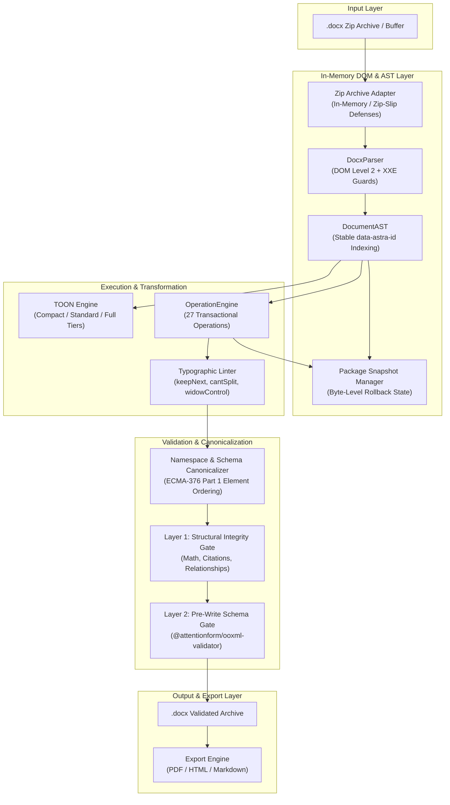

# ASTra Architecture & System Design

A comprehensive architectural overview of the ASTra headless OOXML engine, addressing model, transaction engine, and validation pipeline.

---

## Table of Contents

1. [Architectural Overview & Topology](#1-architectural-overview--topology)
2. [In-Memory DOM & Stable Node Addressing](#2-in-memory-dom--stable-node-addressing)
3. [Token-Optimized Outline Notation (TOON)](#3-token-optimized-outline-notation-toon)
4. [Transactional Operation Engine](#4-transactional-operation-engine)
5. [Schema Sequence Ordering & Namespaces](#5-schema-sequence-ordering--namespaces)
6. [Dual-Gate Validation Architecture](#6-dual-gate-validation-architecture)
7. [Privacy & Sanitization Pipeline](#7-privacy--sanitization-pipeline)
8. [Export & Visual Telemetry Architecture](#8-export--visual-telemetry-architecture)

---

## 1. Architectural Overview & Topology

ASTra was engineered from the ground up to solve the core defect of legacy document libraries: **silent document corruption during programmatic editing**.

Existing tools treat `.docx` documents as either unformatted plain text or raw XML string buffers. ASTra establishes an in-memory DOM Level 2 abstraction specifically designed for autonomous AI agents and automated pipelines:



---

## 2. In-Memory DOM & Stable Node Addressing

### 2.1 Pure In-Memory ZIP Handling
ASTra loads `.docx` zip packages directly into memory. At no point is an archive extracted to temporary directories on disk. This completely eliminates directory traversal attacks (Zip-Slip). In addition, all XML parsers enforce strict XML External Entity (XXE) defenses, refusing `<!DOCTYPE` and `<!ENTITY` definitions prior to DOM traversal.

### 2.2 Stable Addressing (`data-astra-id`)
When a document is parsed, ASTra walks the `w:body` container and indexes all nodes with stable identifiers:
- **Paragraphs (`w:p`)**: Reuses native `w14:paraId` 8-character hexadecimal tokens when present (e.g. `4F3A2B1C`), minting a valid replacement when missing. A repeat paragraph sharing one native paraId keeps a `<paraId>_dup` session id instead, and saving refuses until the repeat is deleted and its text reinserted for a fresh id.
- **Tables (`w:tbl`)**: Indexed sequentially (`t_001`, `t_002`).
- **Structured Document Tags (`w:sdt`)**: Traversed recursively so wrapped forms, controls, and fields remain fully addressable.

These IDs persist throughout the entire lifecycle of an editing session. An AI agent can inspect a document, retrieve a stable node ID, and target mutations with 100% precision without relying on fragile string offsets.

### 2.3 Optimistic Concurrency Control
Every node in the `DocumentAST` maintains an internal `version` counter and SHA-256 content checksum. If multiple agent loops or automated scripts attempt to modify the same node concurrently, mutations fail closed with a version mismatch notification, preventing race-condition overwrites.

---

## 3. Token-Optimized Outline Notation (TOON)

### 3.1 The Context Window Challenge
Standard OpenXML markup contains an extreme ratio of syntax noise to substantive text. A typical 100-page corporate filing requires over **63,000 raw XML tokens** for `word/document.xml`. Dumping raw XML into an LLM prompt degrades model attention and rapidly exhausts context budgets.

### 3.2 Tiered Representation
ASTra's TOON engine converts verbose XML trees into a compact, human- and LLM-readable tabular notation across three fidelity tiers:

| Tier | Format & Characteristics | Relative Token Overhead | Use Case |
|---|---|:---:|---|
| **`compact`** | Minimal pipe-delimited table containing node ID, version, type, and text. Table cells rendered as coordinate pairs (`r1c1 Metric \| r1c2 Value`). | **~10% of raw XML** | Global document scanning, outline generation, navigation. |
| **`standard`** | Compact outline plus terse inline formatting tags (`[B]`, `[I]`, `[C:hex]`, `[SZ:n]`, `[HDR]`, `[ZEBRA]`). | **< 1.5x compact** | General agent editing turns, styling inspection. |
| **`full`** | Deep structural dump detailing margins, borders, run properties, and twip geometries. Scoped strictly to one section at a time. | **High (section-scoped)** | Surgical formatting audits and micro-layout adjustments. |

### 3.3 Dynamic Token Budgeting
When an agent is operating under strict context limits, the engine provides `generateTokenBudgetToon(ast, maxTokens)`. The algorithm calculates token consumption in real-time (`ceil(length / 3.8)`) and dynamically compacts text columns to guarantee that output stays within the declared token budget on clean row boundaries. When compression alone cannot fit the budget, the call slices on row boundaries and reports cursor fields (`{ truncated, hasMore, nextOffset }`) so the caller pages the remainder with `{ offset: nextOffset }`; a single row larger than the budget is still returned with `truncated` set, so paging always terminates.

---

## 4. Transactional Operation Engine

### 4.1 The 27-Operation Discriminated Union
ASTra operations are modeled as a strongly-typed Zod discriminated union (`action`), guaranteeing complete schema validation before any DOM mutation occurs:

```typescript
type Operation =
  | InsertOperation       // Adds paragraph, run, or container
  | ReplaceOperation      // Replaces node text or formatting
  | DeleteOperation       // Removes nodes idempotently
  | StyleOperation        // Applies inline or block typography
  | ClearFormatOperation  // Resets run properties to inherited styles
  | MoveOperation         // Repositions nodes within the DOM
  | TableOperation        // Modifies rows, columns, grids, or cells
  | SectionOperation      // Splits sections or defines breaks
  | PageSetupOperation    // Modifies margins, orientation, twip sizes
  | NamedStyleOperation   // Defines or updates paragraph/character styles
  | FieldOperation        // Inserts dynamic fields (e.g. Page numbers)
  | EquationOperation     // Embeds native OMML math equations
  | ListOperation         // Creates or modifies bullet/numbered lists
  | HeaderFooterOperation // Binds header/footer parts to sections
  | ChartOperation        // Inserts or updates native 2D/3D charts
  | ImageOperation        // Embeds DrawingML raster/vector graphics
  | CalloutOperation      // Inserts executive alert callouts
  | FootnoteOperation     // Manages footnotes and separators
  | EndnoteOperation      // Manages endnotes and numbering
  | WatermarkOperation    // Applies diagonal/horizontal text watermarks
  | PageBorderOperation   // Configures artistic or line page borders
  | CoverPageOperation    // Generates executive front-matter covers
  | HyperlinkOperation    // Embeds external links and relationships
  | BookmarkOperation     // Creates anchor bookmarks for cross-refs
  | CommentOperation      // Adds review comments with author metadata
  | TrackedChangeOperation// Records w:ins and w:del revisions
  | MetadataOperation;    // Updates core/extended document properties
```

### 4.2 Atomic Snapshotting & Rollback
Before executing any batch:
1. The engine creates an immutable memory clone of the `DocumentAST`.
2. The engine captures a byte-level snapshot of all internal package parts (`capturePackageSnapshot`).
3. Operations execute sequentially in document order (`sequential: true`).
4. If an operation encounters an error or introduces an invalid XML state, `restoreAfterFailedBatch()` immediately reverts the document to the pre-batch snapshot.
5. The document is left exactly as it was before the batch.

---

## 5. Schema Sequence Ordering & Namespaces

### 5.1 ISO/IEC 29500 Element Sequencing
In the OpenXML specification, child elements within property containers must occur in exact alphabetical and structural sequence. For example, within `<w:pPr>`, `<w:pStyle>` must appear before `<w:spacing>`, which in turn must appear before `<w:rPr>`. Reversing this sequence results in documents that Microsoft Word flags as corrupted.

ASTra enforces strict child order tables:
- `PPR_CHILD_ORDER`: Defines exact sequence for paragraph properties.
- `RPR_CHILD_ORDER`: Defines exact sequence for run properties.
- `TBLPR_CHILD_ORDER` & `TRPR_CHILD_ORDER`: Defines sequence for table and row properties.

When mutations occur, `appendInSchemaOrder()` inserts new child tags at the schema-compliant position, and `canonicalizeDocumentDom()` automatically sorts any legacy non-conforming elements.

### 5.2 Canonical Namespaces
ASTra preserves and normalizes standard OOXML namespace prefixes across all parts:
- `w:`: WordprocessingML (`http://schemas.openxmlformats.org/wordprocessingml/2006/main`)
- `w14:`, `w15:`: Word 2010/2013 Extensions
- `a:`: DrawingML Framework
- `pic:`: DrawingML Picture
- `c:`: DrawingML Chart
- `r:`: Office Document Relationships
- `m:`: Office Math Markup Language (OMML)

---

## 6. Dual-Gate Validation Architecture

To protect document integrity, ASTra runs every change through two independent validation layers:

```text
Mutation Candidate
       ↓
[ Layer 1: Structural AST Gate ] ──→ Verifies relationship IDs, equation integrity,
       ↓                             citation balance, and tracked-change safety.
[ Layer 2: ECMA-376 Schema Gate ] ──→ Full ISO/IEC 29500 schema gate (@attentionform/ooxml-validator)
       ↓                             checking elements, attributes, and sequences.
Commit to Disk (.docx)
```

1. **Layer 1: Structural Integrity Gate**
   - Asserts that all relationship targets (`r:id`) resolve to valid entries in `word/_rels/document.xml.rels`.
   - Verifies that equation count (`m:oMath`) and citation fields (`w:fldSimple`) remain balanced.
   - Prevents silent deletion of tracked revisions (`w:ins` / `w:del`).
2. **Layer 2: ECMA-376 Schema Gate**
   - Invokes `@attentionform/ooxml-validator` across all modified XML parts via high-performance streaming worker IPC (with in-memory buffer validation and zero temp files on the buffer path).
   - If any violation is detected, the engine aborts the commit and emits a structured error with a specific remediation path.

---

## 7. Privacy & Sanitization Pipeline

The `sanitizer` module provides an automated cleaning engine that removes identifying information:
- **RSID Stripping**: Cleans all `w:rsidR`, `w:rsidRPr`, and `w:rsidRoot` tracking tags to eliminate document edit lineage.
- **Author Masking**: Replaces author and commenter names across revisions, comments, and core metadata (`dc:creator`, `cp:lastModifiedBy`) with empty strings or a generic identifier.
- **Image Metadata Scrubbing**: Strips EXIF, XMP, and Photoshop metadata chunks from embedded PNG and JPEG images.
- **PII Redaction (`--client-safe`)**: Redacts telephone numbers, email addresses, SSNs, and credit cards from body text while preserving statutory contract and legal clause citations (e.g. `FAR 52.204-21` and `DFARS 252.204-7012`).

---

## 8. Export & Visual Telemetry Architecture

### 8.1 Headless Export Pipeline
ASTra supports direct export to PDF, HTML, and Markdown:
- **PDF Export**: Executes headless LibreOffice (`libreoffice` / `soffice`) in an isolated temporary environment. Includes an automated preflight check that validates note presentations and falls back gracefully to accessible tagged PDF generation.
- **HTML Export**: Emits clean semantic HTML5 with styled table grids, embedded SVG vector charts, and responsive typography.
- **Markdown Export**: Generates GitHub Flavored Markdown (GFM) with table alignments, math blocks, and alert callouts (`> [!NOTE]`).

### 8.2 2D Spatial Telemetry
The `visual_inspect` module provides geometric layout analysis without requiring GUI rendering:
- Computes exact page dimensions, margins, and header/footer bounds in twips.
- Generates ASCII wireframes of page text flow (< 500 tokens).
- Flags potential layout defects (e.g. orphan headings or table splits across page breaks) before documents are exported.
